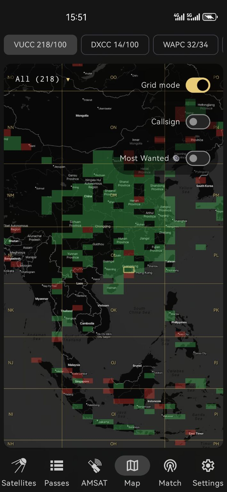
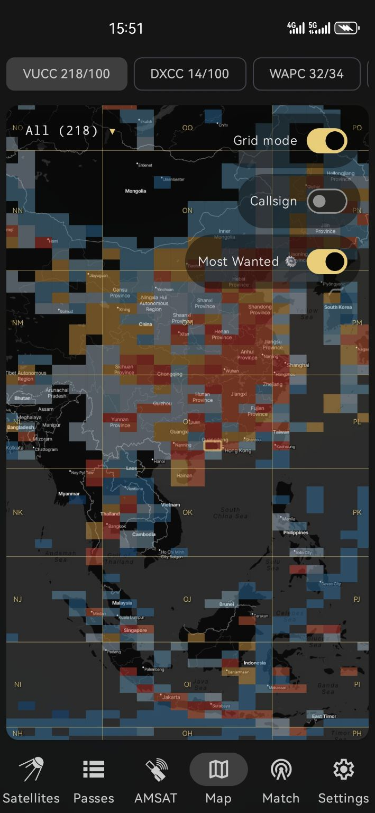
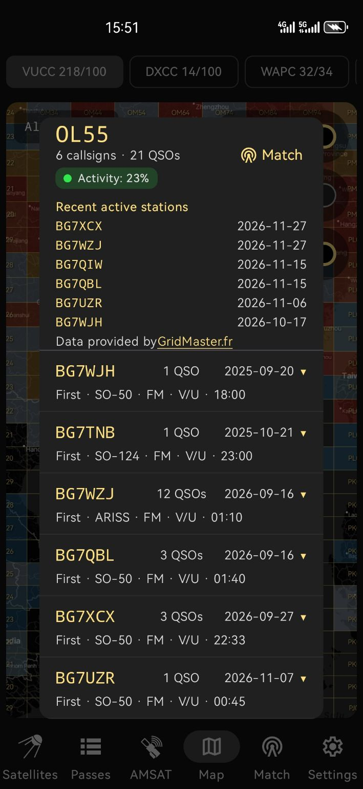
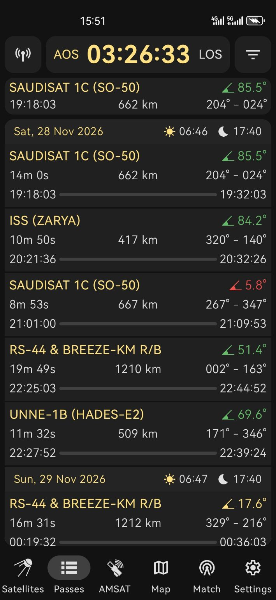
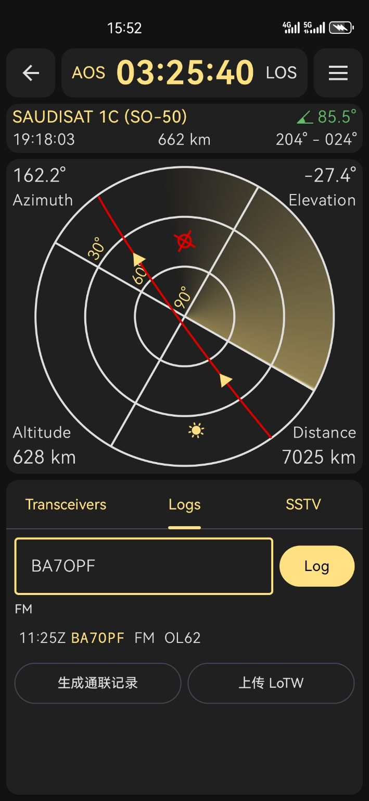
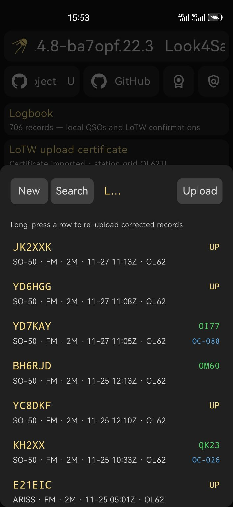
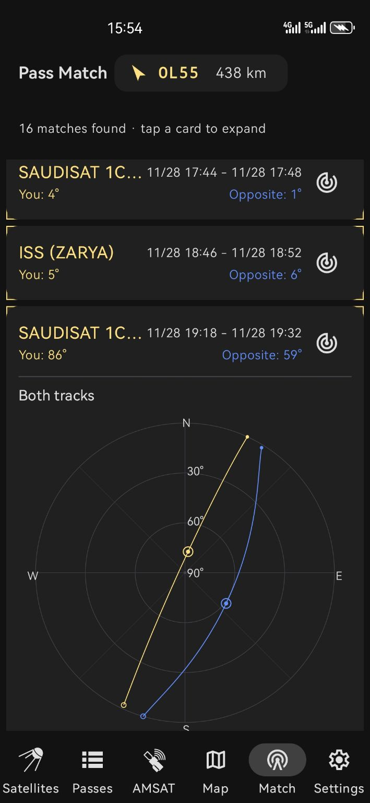

<!--
  Look4Sat — BA7OPF Edition
  Independently maintained fork of rt-bishop/Look4Sat.
-->

<div align="center">
  

  <h1>Look4Sat — BA7OPF Edition</h1>

  <p><strong>Satellite tracking, pass prediction, and operating tools for amateur radio operators.</strong></p>

  <p>
    <a href="https://github.com/atsunatsu/Look4Sat/releases/latest">
      
    </a>
    <a href="https://github.com/atsunatsu/Look4Sat/releases">
      
    </a>
    <a href="https://github.com/atsunatsu/Look4Sat/blob/main/LICENSE">
      
    </a>
    
  </p>

  <p>
    <a href="https://github.com/atsunatsu/Look4Sat/releases/latest"><strong>Download APK</strong></a>
    · <a href="https://github.com/atsunatsu/Look4Sat/releases">All releases</a>
    · <a href="https://github.com/rt-bishop/Look4Sat">Upstream project</a>
  </p>
</div>

> **About this repository:** This is an independently maintained fork of [rt-bishop/Look4Sat](https://github.com/rt-bishop/Look4Sat), with additional features for satellite operators and amateur-radio logging. It is not the upstream project. Upstream tracking functionality and the original project remain credited to their authors.

## Screenshots

Current BA7OPF Edition (v4.4.8-ba7opf.22.3).

<p align="center">
  
  
  
  
</p>
<p align="center">
  
  
  
</p>

## Features

### Satellite tracking and prediction

- Track thousands of satellites using orbital data from **CelesTrak**, **SatNOGS**, **AMSAT**, **ARISS**, and configurable sources.
- Calculate satellite positions and predict passes up to **10 days ahead** with SGP4/SDP4.
- Browse upcoming and active passes, including pass progress, visibility, and orbital information.
- Explore satellite footprints, ground tracks, and positions on an interactive map or polar radar.
- Import and update orbital elements in TLE and OMM/CSV formats. Add custom TLE or CSV sources and manage their order.
- Use **CelesTrak ISS SupGP** data, derived from NASA Orbital Ephemeris Message (OEM) fits, for time-appropriate ISS predictions. Cached segments and ordinary ISS elements provide fallback coverage.

### Amateur-radio operating tools

- Browse satellite transponders and their uplink/downlink information.
- Calculate Doppler-corrected TX/RX frequencies for linear transponders, including passband mapping and user-defined frequency offsets.
- Control supported radios through available USB/serial, Bluetooth SPP, or Hamlib `rigctld` connections. Supported models and capabilities depend on the selected radio profile.
- Decode CW with a live text display and waterfall.
- Use the CW operating console and message presets during a pass.
- Receive and decode SSTV images.
- View the AMSAT satellite status timeline, including recent reports, and submit satellite status reports.
- Find **mutual passes**: identify satellites that are simultaneously visible from two ground stations, compare their elevation curves, and open the pass in the radar or map view.

### Grid maps and award tracking

- View Maidenhead grid squares and VUCC-oriented worked-grid coverage on the map.
- Keep worked grids and manually marked grids separate, with station-specific records and an aggregated **All** station view.
- Inspect grid details, local QSO records, and first-worked callsigns.
- Use **GridMaster** satellite activity data to display:
  - Most Wanted grid activity percentages.
  - A grid activity time heatmap based on the latest reported activity.
  - Recent active callsigns for individual grids.
- Filter the activity heatmap by its time bands.
- Overlay award and geographic boundaries, including **DXCC, WAPC, WAJA, WAZ, WAS, and WAIPA**.
- Draw configurable satellite elevation contours on the map.

### QSO logging and synchronization

- Keep a local satellite QSO logbook and associate contacts with satellite passes and transponders.
- Exchange log records using ADIF-compatible data.
- Synchronize confirmed QSOs and worked grids with **ARRL Logbook of The World (LoTW)**.
- Upload eligible QSOs to LoTW using an imported LoTW certificate.
- Connect to **Wavelog** to retrieve and upload QSOs. Where supported by the server API, confirmation updates can also be synchronized incrementally.
- Review upload previews and validation results before submitting records.

### Designed for everyday use

- Ad-free and offline-first: orbital calculations run on the device, and downloaded data is cached locally.
- Multiple station locations and Maidenhead locators.
- Configurable satellite and transponder data sources.
- Local map data is available; online map layers and external integrations require a network connection.
- Localized interface: English, Chinese, Spanish, Russian, Sinhala, Turkish, and Ukrainian.

## Getting started

1. Install the APK from [GitHub Releases](https://github.com/atsunatsu/Look4Sat/releases/latest).
2. Open **Settings** and set your station location. Use an accurate latitude/longitude or Maidenhead locator.
3. Update the satellite orbital data sources.
4. Select a satellite to inspect its next passes, open the radar, or view its ground track on the map.
5. Configure a radio, logbook, or external service only if you need those features.

For reliable predictions, keep orbital elements up to date and make sure your station location is correct.

## Download and compatibility

- **Minimum Android version:** Android 7.0 (API 24).
- **Download:** [Latest APK and release notes](https://github.com/atsunatsu/Look4Sat/releases/latest).
- **Package ID:** `cn.ba7opf.look4sat`. This fork uses a different application ID from upstream, so it installs as a separate app and does not share the upstream app's local data.

Please use the release notes to review changes before updating.

## Data sources and attribution

Look4Sat uses data and services provided by several independent projects:

- [CelesTrak](https://celestrak.org/) — satellite orbital elements, including ISS SupGP.
- [SatNOGS](https://satnogs.org/) — satellite and transmitter information.
- [AMSAT](https://www.amsat.org/) — amateur-satellite information and status reporting.
- [GridMaster](https://gridmaster.fr/) — aggregated satellite grid activity and recent activator data.
- [ARRL LoTW](https://lotw.arrl.org/) — QSO confirmation and upload services.
- [Wavelog](https://www.wavelog.org/) — self-hosted amateur-radio logbook integration.

Grid activity data displayed by this application is attributed to **[GridMaster.fr](https://gridmaster.fr/)**. The GridMaster integration reads public aggregate data; it does not upload your local QSO records or callsigns to GridMaster.

External services are optional unless a feature requires them. Their availability, API limits, and terms are controlled by their respective providers.

## Build from source

The project uses Kotlin, Jetpack Compose, Gradle, and the Android SDK.

Requirements:

- JDK 17
- Android SDK
- Android 7.0 (API 24) or later for the installed application

Build a debug APK:

```bash
git clone https://github.com/atsunatsu/Look4Sat.git
cd Look4Sat
./gradlew assembleDebug
```

Run unit tests:

```bash
./gradlew test
```

## Upstream project and acknowledgements

This project is based on [Look4Sat by Arty Bishop (rt-bishop)](https://github.com/rt-bishop/Look4Sat). The upstream project provides the original Android satellite-tracking foundation, orbital prediction, and core application architecture.

Thanks to the maintainers and contributors of CelesTrak, SatNOGS, AMSAT, GridMaster, LoTW, Wavelog, and the open-source libraries used by this application.

See [THIRD_PARTY_NOTICES.md](THIRD_PARTY_NOTICES.md) for third-party notices and attributions.

## License

This project is licensed under the **GNU General Public License v3.0**. See [LICENSE](LICENSE).
